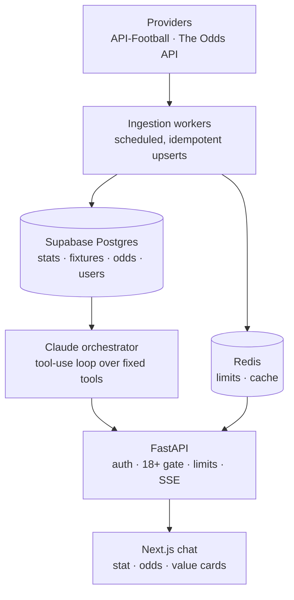

# Oddsmith

*The tipster the bookies would send off.*


Oddsmith is an AI chatbot for pre-match Premier League betting questions. It answers with live stats, injuries and odds from UK bookmakers, and it cites every figure with a source and an as-of time. Claude never calls a data provider or writes SQL. It reads a curated Postgres database through a fixed set of typed tools, so a number either comes from a tool result or isn't stated. It gives a view, not a tip, and never sells a "lock".

## Status

**Portfolio project, paused.** Built 6–28 October 2026 and briefly deployed (Railway for the API, ingestion cron and Redis; Vercel for the web app; Supabase for Postgres and auth). The paid services have since been cancelled, so the live site is offline. Everything below runs locally.

## What it answers

- "How has Saka done away from home this season?"
- "Who's injured for Villa vs Spurs?"
- "Do Brentford games usually go over 2.5?"
- "What's the best price on Newcastle to win?"
- "Is there value in Newcastle to win?"

Scope was cut hard: Premier League 2026/27 only, as a mobile-first web chat. It takes no bets and has no affiliate links. Full scope: [`SPEC.md`](SPEC.md).

## Architecture



**The key rule:** data flows one way. Only the ingestion workers call providers, so user traffic can't burn API quota. Claude reads the database only through the tools in [`oddsmith_tools.json`](oddsmith_tools.json). It never calls a provider and never writes SQL. Every tool returns the same envelope (`ok`, `source`, `as_of`, `is_stale`, `freshness_limit_hours`, `warnings`, `data`), and every number in an answer is cited with its source and as-of time. Stale data is flagged before it's used (odds 6h, availability 24h, fixtures 48h; finished-match stats are stale only if a result is missing 3h after kick-off).

| Tool group | Tools |
| --- | --- |
| Lookup | `resolve_entity` |
| Stats | `get_player_stats`, `get_team_stats`, `get_head_to_head`, `get_fixtures`, `get_league_table` |
| Context | `get_availability` (`search_news` is defined but switched off for the beta) |
| Market | `get_odds`, `get_odds_movement`, `compare_to_market` |

## Highlights

### Contract-first parallel build

The contracts came first: the database schema, the 11 tool schemas and result envelope in [`oddsmith_tools.json`](oddsmith_tools.json), an OpenAPI spec with the SSE event order in [`contracts/`](contracts/README.md), and the orchestrator's `answer()` interface. Then four lanes built in parallel, each in its own git worktree and branch: ingestion, orchestrator, backend and web. A lead lane on `main` owned the contracts and migrations and merged only tested commits. Each lane has its own `CLAUDE.md` setting out which files it owns, and the web app's generated API types are checked against the OpenAPI spec (`npm run check:api`).

### Eval harness

The harness lives in [`api/orchestrator/eval/`](api/orchestrator/eval/) and its results are in [`REPORT.md`](api/orchestrator/eval/REPORT.md). It runs 50 questions against the real database and the real Claude API. Each answer is checked automatically for:

- every number matching a tool result
- dates and times in UK time
- citations with the correct as-of time
- stale data flagged and estimates labelled
- banned wording
- the tool-call cap

An Opus judge then reads each answer claim by claim.

- **Tool-vs-SQL sweep:** runs every tool across the whole database and compares it with independent SQL. The final sweeps covered 1,835 tool calls with 0 mismatches.
- **Results:** the first run passed 30 of 50. By run 5 the full set passed 49 of 50, and run 9 (run 8's failures plus every value question) was clean. 22 wrong statements were found and fixed, each with a regression test. No tool returned a wrong figure; every fault was in what Claude did with correct results.
- **Measured cost per answer:**

| Model | Answers | Mean | Mean, cold cache | Mean tokens |
| --- | --- | --- | --- | --- |
| Sonnet 5.5 | 42 | $0.0142 | $0.0232 | 16,928 |
| Opus 5.5 | 8 | $0.0377 | $0.0559 | 20,824 |

That is about $0.30 a week for a user asking 10 questions, against a target of £0.50. The daily token budget was re-set from these numbers ([decision 11](DECISIONS.md)).

### Model routing and prompt caching

Sonnet 5.5 answers by default. Value questions ("value", "good bet", "edge") go to Opus 5.5. The model is chosen before the loop starts, because switching mid-loop would lose the prompt cache. The system prompt and tool list are cached, and an answer is capped at 8 tool calls. Tokens are logged per answer, and a global daily token budget shows "back tomorrow" instead of running up a bill.

### Responsible-gambling guardrails

From SPEC "Compliance". The live tests are eval questions g01–g06; unit tests cover the rest.

- **18+ gate** before the first chat, enforced by the backend before `answer()` is ever called.
- **Take a break** for 24h, 7 days or 30 days, which blocks chat right away (stored in a table, not in the login token).
- **GamCare and GAMSTOP** in the footer and settings.
- **Banned wording.** "Lock", "banker", "guaranteed", "sure thing" and "can't lose" are banned in the system prompt, a UI copy test and the eval checks, even when refusing or quoting the user.
- **Estimates labelled.** Every value view shows model %, implied % and edge, marked "Estimate, not advice".
- **Distress handling.** Chasing losses, being under 18 or being self-excluded switches the answer to support mode, with no betting content.

### Tests

Counts from a run on `main` on 2 November 2026:

| Suite | Tests | Notes |
| --- | --- | --- |
| `api/` (backend + orchestrator) | 506 passed | pytest against a real local Postgres, fake Redis, mocked Claude |
| `ingestion/` | 182 passed | 94% line coverage; recorded provider responses, no live calls |
| `web/` | 174 passed (15 files) | Vitest; plus typecheck, lint, `next build` and a Playwright end-to-end flow against a fake orchestrator |

## Tech stack

| Layer | Choice |
| --- | --- |
| Data | API-Football (stats, fixtures, injuries), The Odds API (UK bookmaker prices) |
| Ingestion | Python 3.12, `uv`, scheduled jobs (`seed_reference`, `backfill_season`, `sync_fixtures`, `sync_results`, `sync_availability`, `sync_odds`) on a 30-minute cron tick |
| Database | Supabase Postgres 17 + Auth, RLS on every table with no policies (server-side access only); Redis for limits and cache |
| LLM | Claude via the Anthropic API: Sonnet 5.5 by default, Opus 5.5 for value questions |
| API | FastAPI, asyncpg, Server-Sent Events, Sentry |
| Web | Next.js 16, React 19, Tailwind CSS 4, shadcn/ui, Vitest, Playwright |

## Repository layout

| Path | What |
| --- | --- |
| [`SPEC.md`](SPEC.md) | MVP spec: the source of truth for scope |
| [`DECISIONS.md`](DECISIONS.md) | Settled decisions that override older wording in the spec |
| [`HANDOFF.md`](HANDOFF.md) | Status, local environment, routines, session log |
| [`contracts/`](contracts/README.md) | HTTP + SSE API (OpenAPI) and the orchestrator interface |
| [`oddsmith_tools.json`](oddsmith_tools.json) | Tool schemas and the result envelope |
| `supabase/migrations/` | Database migrations |
| `db/test-db.sh` | Builds a per-lane test database |
| `ingestion/` | Scheduled workers: providers → Postgres |
| `api/orchestrator/` | Tools, Claude tool-use loop, system prompt, eval harness |
| `api/` | FastAPI: auth, gates, limits, SSE, persistence |
| `web/` | Next.js chat app |

## Local setup

You need Docker, the [Supabase CLI](https://supabase.com/docs/guides/cli), [`uv`](https://docs.astral.sh/uv/) and Node with npm 11.

```bash
cp .env.example .env      # then fill in the keys; `supabase status` prints the local Supabase ones
supabase start            # Postgres (54322), Auth API (54321), Studio (54323), email inbox (54324)
supabase db reset         # apply supabase/migrations/
docker compose up -d      # Redis on 6379
```

The API and the ingestion workers read the repo-root `.env`. The web app needs the `NEXT_PUBLIC_*` values in its own environment (for example `web/.env.local`). Loading real data and asking real questions need your own API-Football, The Odds API and Anthropic keys. The test suites need none of them.

### Run

```bash
# API on http://localhost:8000
cd api && uv run uvicorn app.main:create_app --factory --port 8000

# Web on http://localhost:3000
cd web && npx npm@11 install && npm run dev

# Ingestion: one job at a time (uses API-Football and Odds API quota)
cd ingestion && uv run python -m oddsmith_ingestion.cli seed_reference
```

Ingestion jobs and the first-load order are in [`ingestion/DEPLOY.md`](ingestion/DEPLOY.md). Deployment runbooks: [`api/DEPLOY.md`](api/DEPLOY.md) and [`ingestion/DEPLOY.md`](ingestion/DEPLOY.md).

### Test

```bash
db/test-db.sh <ingestion|orchestrator|backend|lead>   # builds a test database and prints its URL

cd api && uv run pytest -q && uv run ruff check
cd ingestion && uv run pytest -q && uv run ruff check
cd web && npm test && npm run typecheck && npm run check:api
```

The suites read their database URL from `TEST_DATABASE_URL` and `ORCHESTRATOR_TEST_DATABASE_URL` (api), or `INGESTION_TEST_DATABASE_URL` (ingestion).

## Decisions

Choices that changed or sharpened the spec are logged with their reasons and consequences in [`DECISIONS.md`](DECISIONS.md). They cover:

- one Supabase Postgres for everything
- the model split and its measured cost
- keeping the odds feed on its free tier
- how finished-match data gets its as-of time
- the beta token budget

## What I'd do next

From the open items in [`HANDOFF.md`](HANDOFF.md) and the eval report:

- **Before any public launch:** check the data licences for API-Football and The Odds API, get the draft terms and privacy policy reviewed, and move to Supabase Pro.
- **Budget:** a cost-based daily budget, or Opus tokens counted double, before growing past about 20 testers. This needs cache-read and cache-write counts added to the `usage` event (a contract change).
- **Data quality:** store full player names (they're stored as initial + surname), clean HTML entities out of names, and add more bookmakers for over/under prices (currently one).
- **Sign-in:** a six-digit code instead of a bare magic link.
- **Ops:** `/health` reporting the running commit, and alerts when a Railway or Vercel deploy fails.
- **Later scope:** player-props prices, team news (after a licence check), and a stronger value model than last-10-matches xG Poisson.

## Responsible gambling

Oddsmith was built for adults (18+) in Great Britain. It publishes information and estimates, not advice. If gambling is causing you problems, call GamCare free on 0808 8020 133 or register with [GAMSTOP](https://www.gamstop.co.uk).
